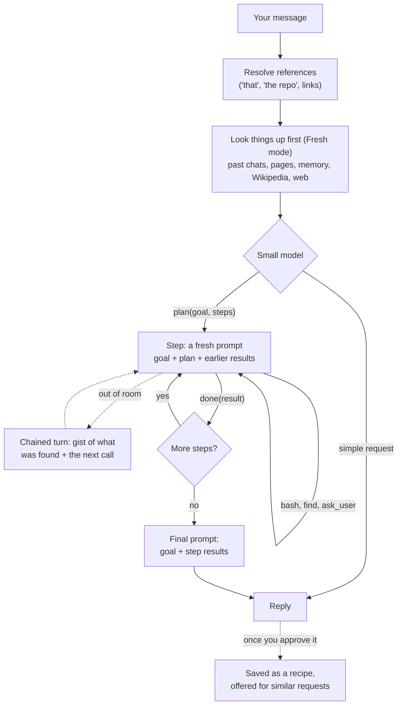

<p align="center"></p>

<h1 align="center">Squiggle</h1>

<p align="center">Getting the most out of an AI agent in a browser, and especially in a phone's.</p>

<p align="center"><a href="https://github.com/KealJones/tilde"></a></p>

<p align="center"><a href="https://kealjones.com/squiggle/"><b>Try it</b></a> (pick "Try it without signing in") · <a href="docs/harness.md">Harness design</a> · <a href="docs/failures.md">Failure casebook</a> · <a href="docs/evals.md">Evals</a> · <a href="docs/lab.md">Lab notebook</a> · <a href="docs/setup.md">Run your own</a></p>

Squiggle is a chat agent with no backend: the app is static files, the model runs on your device, and your chats,
memory and the agent's files live in a **private GitHub repo you own**, so a chat started on a laptop carries on
on a phone. It searches the web, reads pages, looks things up on Wikipedia and Wikidata, keeps a memory of you,
searches every past chat, and works on your repos with git and gh.

The model is small on purpose, and it isn't the point. Squiggle is a working answer to one question: **how much
agent can you get out of a small model in a browser if the harness is good?** Models are swappable (adding one is a
registry entry), so the [lab notebook](docs/lab.md) tracks different small models and strategies against the same
harness.

<!-- screenshot: docs/images/demo.png (docs/images/SHOTS.md) -->

## Built for mobile browsers

A phone's browser tab is a hard place for an agent: about 1.9 GB of memory shared with the GPU, a GPU that iOS takes
away when you switch apps, and a tab that can be killed in the background. Squiggle is built around those limits.

- **The GPU's watchdog:** iOS Safari kills its GPU process when one command runs past ~3 s, so prompts are read
  in 128-token pieces, and a lost GPU is reloaded with the reply carrying on.
- **The right build for the device:** Tilde on WebGPU where it runs, then WebLLM, then llama.cpp in WebAssembly on
  the CPU. The device picks the build.
- **It holds up on a phone:** a ~1 GB 1.7B model in our own WebLLM build writes about 14 tokens a
  second with a 6K window on an iPhone 16 in Safari ([engine.js](app/src/engine.js)).
- **[Tilde](https://github.com/KealJones/tilde)**, my own WebGPU runtime for small models, comes first where it runs,
  loaded from its repo pinned by commit. The default model there also sees pictures and video, hears and speaks.

## How a turn works



Each chat picks how its context is built: Compress (the default: a summary plus recent turns), Smart, Fresh, or
AI-managed (experimental). "What the model saw" on any reply shows the exact prompt. The full contract is
[docs/harness.md](docs/harness.md).

## Harness ideas

- **Many short turns, chained, instead of one long one** ([agent.js](app/src/agent.js)). A bigger request
  becomes a plan, and each step runs in its own fresh prompt with only the goal, the plan and earlier steps'
  results: a clean slate per step, so a long task never fills a small window. When a reply runs out of room
  anyway, it isn't cut off: the harness chains another turn onto it, carrying the gist of what its tools found
  and the call it was about to make, and that turn picks up where the last one left off with far less context.
  You see one continuous answer. In AI-managed mode the model checkpoints itself (four times a turn, then it
  asks you whether to go on).
- **Look up, don't replay** ([prefetch.js](app/src/prefetch.js)). In Fresh mode nothing is replayed just for
  being recent. Before the model answers, the question is made to stand on its own ("what about his newest
  one?" borrows names from the last question), then matching chats, pages, memory, Wikipedia and the web are
  searched. The results go in as a `find` call the model already made, not as text in the user turn, because
  small models read everything in the user turn as the user talking.
- **Keep the fact, not the page.** A step ends with `done(result)`: the one-to-three-line finding the rest of
  the task needs, not a narration. Later steps see those results; raw tool output is saved where `find` can
  reach it but is never replayed.
- **Tool names up front, details on demand.** Declaring every tool schema took about 3.4K tokens of a 4K window.
  Small models now get a few schemas plus a line naming the rest, and call `tool_info(names)` for what they need
  (about 1K tokens in all). Models trained with deferred tools get only bash, the web and `search_tools` up front;
  the rest are named in the prompt, and `search_tools` brings back their definitions in bundles.
- **One `bash` tool** ([tools/bash.js](app/src/tools/bash.js)). A shell over the workspace with git and gh that
  behave like the real ones, plus curl, search, wiki, node and bc. Every command that reaches the network or
  GitHub goes through the same approvals and URL rules as the standalone tools.
- **Survives losing focus** ([resume.js](app/src/resume.js)). iOS kills background tabs and drops the GPU. A
  turn checkpoints to localStorage as it streams, so on return the reply resumes mid-step or mid-sentence, the tool
  calls it already made aren't run again, and a cap of two tries keeps a tab killed for memory from looping.
- **Prompt reuse** ([prefix-cache.js](app/src/prefix-cache.js)). Re-reading a 3K prompt on every tool call was
  most of a reply's time on a phone. Models with conv layers can't rewind their cache, so Squiggle forks a cached
  sequence instead; in a scripted tool loop that halves the prompt tokens read. On by default since it passed on an iPhone.
- **Memory with an absolute bar** ([memory-rank.js](app/src/memory-rank.js)). A fact scores by how much of it the
  question covers, so when nothing fits, nothing comes back. On a labelled set, unrelated questions that get no
  fact went from 50% (normalized BM25) to 88% ([docs/evals.md](docs/evals.md)).

<!-- screenshot: docs/images/context.png (docs/images/SHOTS.md) -->

## Every bad answer is evidence

[docs/failures.md](docs/failures.md) is a casebook of 21 real bad answers. Each has the chat id, the model, the
tool calls, why it's wrong, the right answer, the fix and the unit test that now catches it. Case 1:

> **Asked:** "What is Emma Stone's real name?" **Answered:** "Emma Stone's real name is Keal."
> `find` matched the memory "the user's name is Keal" on the word "name". Now a question that names someone only
> takes memory that names them too.

The bad answers never go in a prompt or a training set; each one is the rejected half of a preference pair. The
cases also run as an eval against a real model ([docs/evals.md](docs/evals.md)).

<!-- screenshot: docs/images/steps.png (docs/images/SHOTS.md) -->

## Safety, in code

- **Pushes to anything but the agent's own `agent/…` branches need your click.** Never a force-push; a push that
  touches `.github/workflows/` asks every time. Approval only comes from the UI, never from model output.
- **The model never sees your GitHub token.** Tools reach it through closures; model-written JavaScript runs in an
  opaque-origin iframe with no access to storage or the token.
- **Outside text is data.** Pages, repo files and tool output are wrapped in `<untrusted>` tags with a per-session
  key. The limits above don't depend on the model obeying that.

<!-- screenshot: docs/images/approval.png (docs/images/SHOTS.md) -->

## In progress

Open pull requests, not on the live app yet. Each has a preview at `kealjones.com/squiggle/pr-preview/pr-<number>/`.

- [#10](https://github.com/KealJones/squiggle/pull/10): brainstorm chats, where the model talks an idea through with
  itself.
- [#20](https://github.com/KealJones/squiggle/pull/20): `find` with several wordings in one call.
- [#17](https://github.com/KealJones/squiggle/pull/17): an editable system prompt and tool list per chat.

## Supported devices

- **iPhone 16 and newer** in Safari.
- **Desktop** Chrome and Safari with WebGPU.

Other devices may work (without WebGPU it runs on the CPU, slowly), but aren't tested. Older iPhones may not have
the memory for the model in a browser tab.

## Running it

**Try it:** [kealjones.com/squiggle](https://kealjones.com/squiggle/), then "Try it without signing in". It's the
real app with storage in your browser and a sample chat, so memory and search have something to find. Signing in
later moves your demo data into a private repo of yours.

**Locally:**

```bash
npm ci
npm run dev        # the app and the relay Worker at http://localhost:8787
npm run check      # lint + unit tests
npm run test:e2e   # end to end in headless Chromium, with a scripted model
```

Plain ES modules, no framework, no build step; [CLAUDE.md](CLAUDE.md) is the map of the code.

**Your own copy:** [docs/setup.md](docs/setup.md) takes about 10 minutes: a GitHub App, a free Cloudflare Worker
(it relays the few GitHub requests a browser can't make) and your fork on GitHub Pages.

## License

MIT ([LICENSE](LICENSE)). The model weights Squiggle downloads keep their own licenses (the LFM Open License and
the Gemma Terms of Use).
